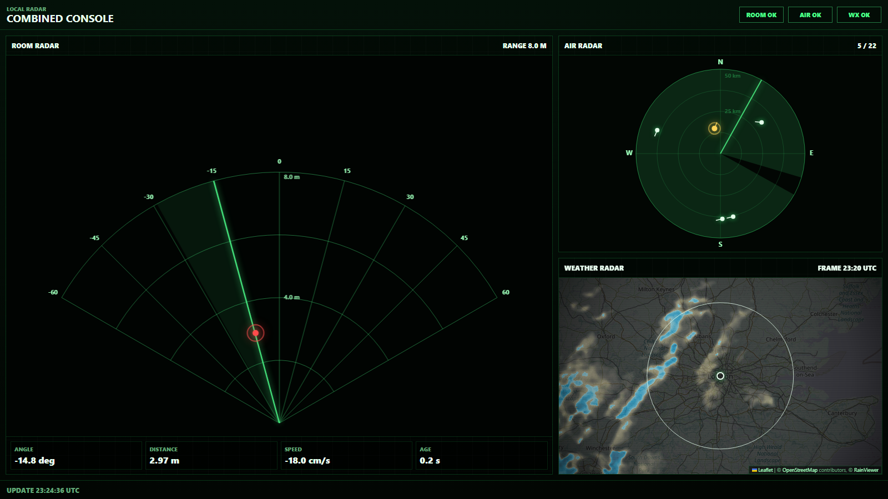
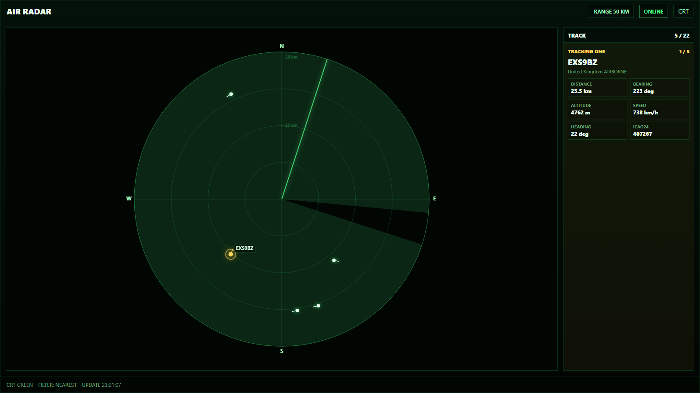
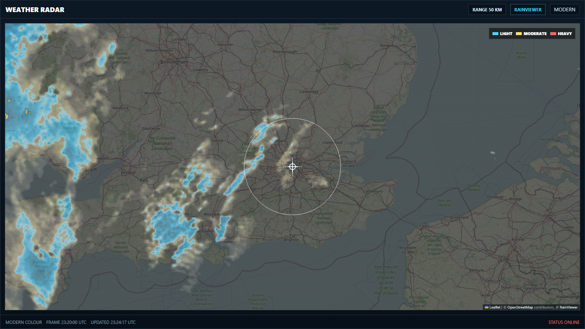

# Multi Radar Project

A desk radar console in your browser. It shows live **aircraft**, **rain radar** and, optionally, **movement in your room** from an mmWave sensor.



| Air Radar | Weather Radar |
| --- | --- |
|  |  |

<sub>Screenshots use central London, with simulated room radar data.</sub>

- **Air Radar:** aircraft within a set range, from [OpenSky Network](https://opensky-network.org).
- **Weather Radar:** live precipitation, from [RainViewer](https://www.rainviewer.com/api.html). No key needed.
- **Room Radar (optional):** an RD-03D sensor on an Arduino, plugged in by USB.

It runs on Windows, macOS, Linux and Raspberry Pi.

---

## Quick start

You need **Python 3.11+**, **Git**, and your latitude and longitude. To get them, right-click a spot in Google Maps and copy the coordinates.

```bash
git clone https://github.com/fpant1/Multi-Radar-Project.git
cd Multi-Radar-Project
python -m venv .venv
```

Activate the environment and install the dependencies:

```bash
# Windows (PowerShell)
.\.venv\Scripts\Activate.ps1

# macOS / Linux / Pi
source .venv/bin/activate
```

```bash
pip install -r requirements.txt
cp .env.example .env
```

On Windows, use `py` instead of `python` and `Copy-Item` instead of `cp`.

Start the server with your own coordinates:

```bash
python -m src.server --lat 51.5072 --lon -0.1276
```

Then open:

- <http://127.0.0.1:8000> for Air Radar. Press `M` to switch to Weather.
- <http://127.0.0.1:8000/combined.html> for all three feeds together.

---

## Configuration

### OpenSky credentials (optional)

The app works without an account, but OpenSky's anonymous rate limits are low. For higher limits, create a free account, create an **API client** in your account settings, and add its values to `.env`:

```text
OPENSKY_CLIENT_ID=your_client_id
OPENSKY_CLIENT_SECRET=your_client_secret
```

`.env` is git-ignored, so your credentials never leave your machine.

### Server options

| Option | Default | Description |
| --- | --- | --- |
| `--lat`, `--lon` | required | Your location in decimal degrees. |
| `--radius-km` | `50` | Radar range. |
| `--interval` | `30` | Seconds between OpenSky updates (minimum 10). |
| `--host` | `127.0.0.1` | Use `0.0.0.0` to open the UI from other devices on your network. |
| `--port` | `8000` | Port to serve on. |
| `--room-port` | none | Arduino serial port, for example `COM5` or `/dev/ttyACM0`. |
| `--room-baud` | `115200` | Arduino baud rate. |
| `--room-range-mm` | `8000` | Room radar display range. |

The app has no login. Only use `--host 0.0.0.0` on a network you trust.

---

## Room radar (optional)

**Hardware:** an Ai-Thinker **RD-03D** mmWave sensor and an **Arduino Mega 2560**. The firmware is in [fpant1/Radar-Project](https://github.com/fpant1/Radar-Project) (PlatformIO).

| RD-03D | Mega |
| --- | --- |
| 5V | 5V |
| GND | GND |
| TX | RX1 (pin 19) |
| RX | TX1 (pin 18). Optional; the sensor uses 3.3 V logic, so use a level shifter. |

1. Flash the firmware with VS Code and PlatformIO.
2. Find the port:
   - Windows: Device Manager → Ports.
   - macOS: `ls /dev/tty.usbmodem*`
   - Linux/Pi: `ls /dev/ttyACM*`. On Linux, also run `sudo usermod -aG dialout $USER`, then log out and back in.
3. Start the server with the port:

   ```bash
   python -m src.server --lat <lat> --lon <lon> --room-port COM5
   ```

4. Open `/combined.html`.

Close any serial monitor first, because only one program can use the port at a time. The server also accepts JSON or CSV lines if you change the firmware; see `src/room_radar_service.py`.

---

## Using it

| Key | Action (main page) |
| --- | --- |
| `M` | Switch between Air and Weather. |
| `T` | Switch theme (CRT green or modern). |
| `L` | Show or hide the highlighted aircraft's label. |
| `R` | Reset the view. |

- **Aircraft:** the radar shows the nearest 30 aircraft, airborne first, and cycles a highlight through the closest 5. `5 / 22` means 5 are shown out of 22 in range.
- **Terminal feed:** for a text table of nearby aircraft without a browser, run `python -m src.main --lat <lat> --lon <lon>`. Add `--once` to fetch one snapshot and exit.
- **API:** the server also serves JSON:
  - `/api/aircraft/latest`
  - `/api/weather/rainviewer/latest`
  - `/api/room-radar/latest`
  - `/api/combined/latest`
  - `/api/health`

  Interactive API docs are at `/docs`.

---

## Troubleshooting

| Problem | Fix |
| --- | --- |
| `Activate.ps1 cannot be loaded` | Run `Set-ExecutionPolicy -Scope CurrentUser RemoteSigned` once. |
| `ModuleNotFoundError` | Activate `.venv` and run `pip install -r requirements.txt`. |
| OpenSky rate-limit errors | Add credentials, or raise `--interval`. |
| No aircraft | Check you entered latitude first, or try a bigger `--radius-km`. |
| Room panel shows `disabled` | Pass `--room-port`. |
| Room panel shows a serial error | Wrong port, or another program has it open. On Linux, check the `dialout` group. |
| Room panel shows `stale` | The Arduino is connected but sending nothing. Check the wiring and the firmware. |
| Port 8000 is in use | Add `--port 8080`. |

---

## Roadmap

The next step is running it full-time on a Raspberry Pi with secure remote access. See [docs/raspberry-pi-plan.md](docs/raspberry-pi-plan.md).

## License

[MIT](LICENSE)
